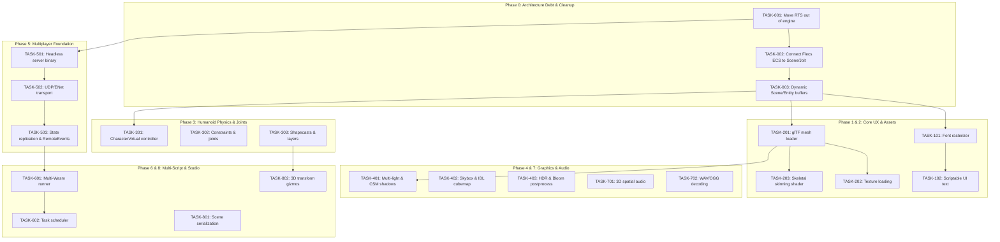

# Master Technical Roadmap & Agent Task Tracker (Roblox-Grade Game Engine)

> **Document Status**: Active  
> **Target Standard**: Comprehensive, Agent-Readable, Automated Task Tracking  
> **Architectural Guardrail**: Strict adherence to [AGENTS.md](file:///c:/Users/janmo/Documents/antigravity/mysterious-bose/agents.md) (Strict Engine vs. Game Separation)

---

## 📋 Task Tracking Metadata Schema

Every task entry follows this structured specification so human contributors and autonomous AI agents can parse, track, and execute tasks unambiguously:

```markdown
### [TASK-XXX] <Task Title>
- **Status**: [ ] Pending | [-] In Progress | [x] Completed
- **Subsystem**: Architecture | ECS | Scripting | Graphics | Physics | Audio | UI | Networking | Assets | Tooling
- **Priority**: P0 (Architectural Debt / Blocker) | P1 (Core Engine) | P2 (Feature) | P3 (Polish / Advanced)
- **Layer Boundary**: Engine (`src/`) | Guest SDK (`scripts/`) | Build/Tooling (`build.zig`, `external/`)
- **Dependencies**: None | TASK-YYY
- **Target Files**: Absolute or workspace-relative file paths
- **Technical Specification**: Concise architectural blueprint and requirements
- **Acceptance Criteria**: Verifiable assertions and test outcomes
- **Verification Command**: Automated CLI command to validate completion
```

---

## 📊 High-Level Milestone Overview

| Milestone | Focus Area | Status | Critical Deliverables |
| :--- | :--- | :--- | :--- |
| **Phase 0** | **Architectural Debt & Strict Separation** | `[x] Completed` | Remove `rts.zig` from engine core, unify Flecs ECS with Scene graph, remove static array limits. |
| **Phase 1** | **Text & SDF Font Rendering** | `[x] Completed` | Glyph atlas / MSDF font rendering, text layout, scriptable UI labels. |
| **Phase 2** | **Asset Pipeline & 3D Formats** | `[x] Completed` | glTF 2.0 loader, image decoder (PNG/KTX2), skeletal bone matrices & skinning shader. |
| **Phase 3** | **Character Controller & Physics Constraints** | `[x] Completed` | Jolt CharacterVirtual (Humanoid physics), physics joints (Hinge/BallSocket/Slider/Weld), shapecasting. |
| **Phase 4** | **WebGPU Visual Fidelity (PBR+Lighting)** | `[x] Completed` | Dynamic multi-lights, Cascaded Shadow Maps (CSM), IBL/Skybox, HDR post-processing, particle systems. |
| **Phase 5** | **Multiplayer Networking & Replication** | `[x] Completed` | Headless server, UDP/ENet transport, RemoteEvents/RemoteFunctions, state snapshot replication. |
| **Phase 6** | **Multi-Script Execution & Task Scheduler** | `[x] Completed` | Multi-instance Wasm runtime, cooperative task scheduler (`task.spawn`, `task.wait`), signal pub-sub. |
| **Phase 7** | **3D Spatial Audio & Mixing** | `[ ] Pending` | Positional audio listener, 3D attenuation/panning, audio asset streaming (WAV/OGG). |
| **Phase 8** | **Creator Tooling & Scene Serialization** | `[ ] Pending` | Scene file serialization (JSON/binary), 3D transform gizmos, in-viewport hierarchy inspector. |

---

## 🛠️ Phase 0: Architectural Debt & Strict Separation (P0)

### [TASK-001] Relocate Game-Specific RTS Logic Out of Engine Core
- **Status**: [x] Completed
- **Subsystem**: Architecture
- **Priority**: P0
- **Layer Boundary**: Engine (`src/`) $\rightarrow$ Guest Script (`scripts/`)
- **Dependencies**: None
- **Target Files**:
  - `src/engine/gameplay/rts.zig` (DELETE or refactor into generic math)
  - `src/engine/engine.zig`
  - `scripts/scene_controller.zig`
  - `test/wasm_scene_test.zig`
- **Technical Specification**:
  - In direct violation of `AGENTS.md`, `src/engine/gameplay/rts.zig` contains game-specific entities (`RtsUnit`, waypoints, 20x20 navigation grids, marquee unit selection).
  - Move `RtsUnit`, `NavGrid`, and unit selection management entirely into `scripts/` (e.g. `scripts/rts_controller.zig` or `scripts/scene_controller.zig`).
  - Keep only domain-agnostic spatial utilities (e.g. ray-plane intersection, camera projection) in `src/engine/math.zig` and `src/engine/camera/camera.zig`.
  - Remove all gameplay exports from `src/engine/engine.zig`.
- **Acceptance Criteria**:
  - No gameplay concepts (units, RTS, teams, waypoints) remain anywhere inside `src/`.
  - All RTS mechanics function 100% via guest WebAssembly scripts.
- **Verification Command**: `zig build test`

---

### [TASK-002] Bridge Flecs ECS Directly into Authoritative Scene & Physics Pipeline
- **Status**: [x] Completed
- **Subsystem**: ECS
- **Priority**: P0
- **Layer Boundary**: Engine (`src/`)
- **Dependencies**: TASK-001
- **Target Files**:
  - `src/engine/ecs/flecs.zig`
  - `src/engine/renderer/scene.zig`
  - `src/engine/physics/jolt.zig`
  - `src/engine/state/game_state.zig`
  - `src/main.zig`
- **Technical Specification**:
  - Flecs ECS is currently stepped in `main.zig` but isolated from rendering and physics.
  - Implement a Flecs synchronisation pipeline:
    1. Physics-to-ECS system: queries dynamic Jolt bodies and writes updated transforms into Flecs `Position` / `Rotation` components.
    2. ECS-to-Scene system: iterates `(Position, Rotation, Scale, MeshRender)` archetypes and prepares render instances.
  - Expose Flecs entity lifecycle to the Outbox reconciliation pass in `src/engine/scripting/outbox.zig`.
- **Acceptance Criteria**:
  - Entities spawned via outbox commands are registered as first-class Flecs entities.
  - Physics movements automatically propagate to Flecs components and render passes.
- **Verification Command**: `zig build test`

---

### [TASK-003] Replace Static Array Limits with Dynamic Capacity in Scene and Host State
- **Status**: [x] Completed
- **Subsystem**: Architecture / Memory
- **Priority**: P0
- **Layer Boundary**: Engine (`src/`) & Guest SDK (`scripts/`)
- **Dependencies**: TASK-002
- **Target Files**:
  - `src/engine/renderer/scene.zig` (`MAX_OBJECTS = 64`)
  - `src/engine/state/game_state.zig` (`MAX_ENTITIES = 128`, `MAX_PLAYERS = 32`)
  - `src/engine/scripting/engine_api.zig`
  - `scripts/engine_api.zig`
- **Technical Specification**:
  - Replace static `MAX_OBJECTS` and `MAX_ENTITIES` caps with dynamically expandable buffers or chunked virtual memory allocation.
  - Ensure dual-mapped memory protection (`DualMappedMemory`) dynamically re-maps or expands physical commit ranges without invalidating guest pointers.
  - Maintain C-ABI struct alignment across memory growth boundaries.
- **Acceptance Criteria**:
  - Scene can allocate and render $> 1,000$ active entities without buffer overflow or crashes.
  - Dual-mapped memory validation passes with dynamically expanding entity tables.
- **Verification Command**: `zig build test`

---

## 🔤 Phase 1: 2D Font Rendering & Scriptable Text UI (P1)

### [TASK-101] Implement MSDF / Glyph Atlas Texture Rasterizer in Renderer
- **Status**: [x] Completed
- **Subsystem**: UI / Graphics
- **Priority**: P1
- **Layer Boundary**: Engine (`src/`)
- **Dependencies**: None
- **Target Files**:
  - `src/engine/renderer/ui.zig`
  - `src/engine/renderer/renderer.zig`
  - `src/engine/renderer/font.zig` (NEW)
  - `src/engine/shaders/ui.wgsl`
- **Technical Specification**:
  - Integrate a lightweight TrueType/OpenType font parser (or embed a pre-baked Multi-channel Signed Distance Field / MSDF ASCII & Latin font atlas).
  - Add text glyph quad generator calculating UV coordinates, glyph metrics (advance, bearing, line height, kerning).
  - Update UI render pipeline shader to support text sampling alongside quad colors.
- **Acceptance Criteria**:
  - Engine can render arbitrary ASCII text strings with customizable font size, screen position, and RGBA color.
  - Crisp text rendering across window resizes without raster blur.
- **Verification Command**: `zig build run`

---

### [TASK-102] Expose UI Text API to Guest WebAssembly SDK
- **Status**: [x] Completed
- **Subsystem**: UI / Scripting
- **Priority**: P1
- **Layer Boundary**: Engine (`src/engine/scripting/`) & Guest SDK (`scripts/`)
- **Dependencies**: TASK-101
- **Target Files**:
  - `src/engine/scripting/engine_api.zig`
  - `scripts/engine_api.zig`
  - `scripts/scene_controller.zig`
- **Technical Specification**:
  - Expose host function:
    `engine_ui_draw_text(text_ptr: u32, text_len: u32, x: f32, y: f32, font_size: f32, r: f32, g: f32, b: f32, a: f32)`
  - Register symbol in `src/engine/scripting/engine_api.zig` (native symbol table).
  - Provide ergonomic wrapper in `scripts/engine_api.zig`: `engine.ui.drawText(...)`.
- **Acceptance Criteria**:
  - Script displays HUD overlay containing FPS counter, active game mode, player health, and unit status using `engine.ui.drawText`.
- **Verification Command**: `zig build test`

---

## 📦 Phase 2: Asset Pipeline & 3D Formats (P1)

### [TASK-201] Build glTF 2.0 / OBJ 3D Mesh Importer
- **Status**: [x] Completed
- **Subsystem**: Assets / Renderer
- **Priority**: P1
- **Layer Boundary**: Engine (`src/`)
- **Dependencies**: None
- **Target Files**:
  - `src/engine/assets/gltf_loader.zig` (NEW)
  - `src/engine/renderer/scene.zig`
  - `src/engine/renderer/primitives.zig`
- **Technical Specification**:
  - Implement a binary/JSON glTF 2.0 parser capable of loading vertex buffers:
    - Positions (`VEC3<f32>`), Normals (`VEC3<f32>`), Tangents (`VEC4<f32>`), UV coordinates (`VEC2<f32>`), Indices (`u16` / `u32`).
  - Support submesh extraction, material definition mapping (roughness, metallic, base color textures).
  - Convert parsed data into engine `Mesh` / `RenderObject` instances.
- **Acceptance Criteria**:
  - Engine loads and renders an external `.gltf` / `.glb` model with proper normals and PBR material properties.
- **Verification Command**: `zig build test`

---

### [TASK-202] Add Texture Asset Loading Pipeline (PNG, QOI, KTX2)
- **Status**: [x] Completed
- **Subsystem**: Assets / Graphics
- **Priority**: P1
- **Layer Boundary**: Engine (`src/`)
- **Dependencies**: None
- **Target Files**:
  - `src/engine/assets/texture_loader.zig` (NEW)
  - `src/engine/renderer/renderer.zig`
  - `src/engine/renderer/material.zig`
- **Technical Specification**:
  - Integrate a zero-dependency image decoder (e.g. QOI or lightweight PNG decoder).
  - Implement GPU texture upload path with automatic mipmap generation on `wgpu.Queue`.
  - Support assigning texture views to `Material` instances (albedo, normal map, metallic-roughness map).
- **Acceptance Criteria**:
  - Multiple distinct textured models render in the scene simultaneously with linear filtering and mipmapping.
- **Verification Command**: `zig build test`

---

### [TASK-203] Implement GPU Skeletal Mesh Skinning Pipeline
- **Status**: [x] Completed
- **Subsystem**: Graphics / Animation
- **Priority**: P2
- **Layer Boundary**: Engine (`src/`)
- **Dependencies**: TASK-201
- **Target Files**:
  - `src/engine/animation/skeleton.zig` (NEW)
  - `src/engine/renderer/renderer.zig`
  - `src/engine/shaders/scene.wgsl`
- **Technical Specification**:
  - Expand vertex structure with `JOINTS_0` (`[4]u16`) and `WEIGHTS_0` (`[4]f32`).
  - Add bone matrix palette uniform / storage buffer to WebGPU bind group (up to 128 bones per rig).
  - Update `scene.wgsl` vertex shader to compute weighted linear skinning matrices ($M = \sum w_i B_i$).
  - Add basic keyframe animation clip sampler for skeletal transforms.
- **Acceptance Criteria**:
  - A rigged avatar model plays a walk/idle skeletal animation cycle smoothly at 60+ FPS.
- **Verification Command**: `zig build test`

---

## 🏃 Phase 3: Character Virtual Controller & Physics Joints (P1)

### [TASK-301] Integrate Jolt `CharacterVirtual` for Roblox-Style Humanoids
- **Status**: [x] Completed
- **Subsystem**: Physics
- **Priority**: P1
- **Layer Boundary**: Engine (`src/`) & Guest SDK (`scripts/`)
- **Dependencies**: None
- **Target Files**:
  - `src/engine/physics/jolt.zig`
  - `src/engine/scripting/engine_api.zig`
  - `scripts/engine_api.zig`
- **Technical Specification**:
  - Jolt provides `JPH_CharacterVirtual` specifically designed for responsive character controllers (jumping, slope sliding, stair stepping, ground snapping).
  - Wrap `JPH_CharacterVirtualSettings` and character update steps inside `src/engine/physics/jolt.zig`.
  - Expose host APIs:
    `engine_character_create(pos, half_height, radius) -> id`,
    `engine_character_set_linear_velocity(id, vx, vy, vz)`,
    `engine_character_get_ground_state(id) -> u32` (on_ground, sliding, in_air).
  - Connect character update to the post-tick reconciliation loop.
- **Acceptance Criteria**:
  - Player character moves up slopes and stairs smoothly without physics jitter or sticking to walls.
- **Verification Command**: `zig build test`

---

### [TASK-302] Expose Jolt Physics Constraints & Joints (Hinge, BallSocket, Slider, Weld)
- **Status**: [x] Completed
- **Subsystem**: Physics / Scripting
- **Priority**: P1
- **Layer Boundary**: Engine (`src/`) & Guest SDK (`scripts/`)
- **Dependencies**: None
- **Target Files**:
  - `src/engine/physics/jolt.zig`
  - `src/engine/scripting/engine_api.zig`
  - `scripts/engine_api.zig`
- **Technical Specification**:
  - Expose Jolt constraint creation C-APIs:
    - `HingeConstraint` (doors, wheels, rotating arms)
    - `BallSocketConstraint` (ragdoll limbs, tow hitches)
    - `SliderConstraint` (pistons, elevators)
    - `WeldConstraint` (rigid multi-part assemblies like Roblox `WeldConstraint`)
  - Expose host functions and outbox commands for dynamic constraint creation and destruction from scripts.
- **Acceptance Criteria**:
  - Guest script can connect two rigid bodies with a hinge joint; child body swings under gravity while constrained to anchor.
- **Verification Command**: `zig build test`

---

### [TASK-303] Add Shapecasting & Collision Filtering Groups
- **Status**: [x] Completed
- **Subsystem**: Physics / Scripting
- **Priority**: P2
- **Layer Boundary**: Engine (`src/`) & Guest SDK (`scripts/`)
- **Dependencies**: None
- **Target Files**:
  - `src/engine/physics/jolt.zig`
  - `src/engine/scripting/engine_api.zig`
  - `scripts/engine_api.zig`
- **Technical Specification**:
  - Add shape cast queries: `castSphere(radius, origin, dir)`, `castBox(half_extents, origin, dir)`.
  - Implement collision layer masking (e.g. Default, Debris, Characters, Water) matching Roblox collision groups.
  - Expose results (hit body, contact point, contact normal, fraction) to guest script environment.
- **Acceptance Criteria**:
  - Shapecasts detect obstacles with exact contact points and normals across static and dynamic bodies.
- **Verification Command**: `zig build test`

---

## 💡 Phase 4: WebGPU Visual Fidelity & Environment ("Future-Is-Bright") (P2)

### [TASK-401] Dynamic Multi-Lighting & Cascaded Shadow Maps (CSM)
- **Status**: [x] Completed
- **Subsystem**: Graphics
- **Priority**: P2
- **Layer Boundary**: Engine (`src/`)
- **Dependencies**: None
- **Target Files**:
  - `src/engine/renderer/lighting.zig` (NEW)
  - `src/engine/renderer/renderer.zig`
  - `src/engine/shaders/shadow.wgsl` (NEW)
  - `src/engine/shaders/scene.wgsl`
- **Technical Specification**:
  - Replace single directional uniform buffer with a structured lighting buffer:
    - Up to 16 point lights (position, radius, color, attenuation).
    - Up to 8 spot lights (position, direction, inner/outer cone, color).
    - 1 directional light with 3-split Cascaded Shadow Map (CSM) depth texture array.
  - Implement shadow depth pass before main color pass.
  - Add PCF (Percentage-Closer Filtering) soft shadow sampling in WGSL fragment shader.
- **Acceptance Criteria**:
  - Objects cast crisp, filtered real-time shadows onto floors and other geometries without shadow acne.
- **Verification Command**: `zig build run`

---

### [TASK-402] Environment Skybox & Image-Based Lighting (IBL)
- **Status**: [x] Completed
- **Subsystem**: Graphics
- **Priority**: P2
- **Layer Boundary**: Engine (`src/`)
- **Dependencies**: None
- **Target Files**:
  - `src/engine/renderer/skybox.zig` (NEW)
  - `src/engine/renderer/renderer.zig`
  - `src/engine/shaders/skybox.wgsl` (NEW)
  - `src/engine/shaders/scene.wgsl`
- **Technical Specification**:
  - Add cubemap texture support in WebGPU pipeline.
  - Render a background skybox with depth clamp (`depth = 1.0`).
  - Calculate diffuse irradiance (spherical harmonics or low-res cubemap) and specular radiance cubemap with roughness mips for realistic metallic PBR reflections.
- **Acceptance Criteria**:
  - Metallic spheres reflect skybox and ambient environment lighting accurately across varying roughness levels.
- **Verification Command**: `zig build run`

---

### [TASK-403] Post-Processing Pipeline (HDR, ACES Tone-Mapping, Bloom)
- **Status**: [x] Completed
- **Subsystem**: Graphics
- **Priority**: P2
- **Layer Boundary**: Engine (`src/`)
- **Dependencies**: TASK-401
- **Target Files**:
  - `src/engine/renderer/postprocess.zig` (NEW)
  - `src/engine/renderer/renderer.zig`
  - `src/engine/shaders/postprocess.wgsl` (NEW)
- **Technical Specification**:
  - Render 3D scene to an offscreen HDR floating-point texture (`rgba16_float`).
  - Add downsample/upsample blur passes for emissive/bright threshold bloom.
  - Implement fullscreen composition pass with ACES Filmic Tone Mapping and gamma correction ($2.2$).
- **Acceptance Criteria**:
  - Glowing materials exhibit realistic bloom glow without blowing out scene color saturation.
- **Verification Command**: `zig build run`

---

### [TASK-404] GPU Particle Emitter Subsystem
- **Status**: [x] Completed
- **Subsystem**: Graphics / FX
- **Priority**: P2
- **Layer Boundary**: Engine (`src/`) & Guest SDK (`scripts/`)
- **Dependencies**: None
- **Target Files**:
  - `src/engine/renderer/particles.zig` (NEW)
  - `src/engine/shaders/particle.wgsl` (NEW)
  - `src/engine/scripting/engine_api.zig`
  - `src/engine/scripting/outbox.zig`
  - `scripts/engine_api.zig`
- **Technical Specification**:
  - Instanced quad particle renderer (position, velocity, life, size, color over life, texture UV frame).
  - Outbox commands for spawning emitter attached to entity or world position.
  - CPU or WebGPU compute shader particle simulation step.
- **Acceptance Criteria**:
  - Guest script can trigger particle bursts (sparks, smoke, explosions) at impact coordinates.
- **Verification Command**: `zig build test`


---

## 🌐 Phase 5: Multiplayer Networking & Replication (P1)

### [TASK-501] Headless Dedicated Server Mode
- **Status**: [x] Completed
- **Subsystem**: Platform / Architecture
- **Priority**: P1
- **Layer Boundary**: Engine (`src/`) & `build.zig`
- **Dependencies**: TASK-001
- **Target Files**:
  - `src/server_main.zig` (NEW)
  - `src/engine/platform/headless.zig` (NEW)
  - `build.zig`
- **Technical Specification**:
  - Add dedicated server executable build step (`zig build server`).
  - Headless runtime initializes Jolt Physics, Flecs ECS, and Server Wasm script without SDL3 window or WGPU device initialization.
  - Operates fixed-rate simulation tick (60 Hz or 30 Hz) with low CPU footprint.
- **Acceptance Criteria**:
  - Headless server executable builds and runs stably in terminal without graphics drivers or window managers.
- **Verification Command**: `zig build server`

---

### [TASK-502] UDP / ENet Transport Layer & Packet Framing
- **Status**: [x] Completed
- **Subsystem**: Networking
- **Priority**: P1
- **Layer Boundary**: Engine (`src/`)
- **Dependencies**: TASK-501
- **Target Files**:
  - `src/engine/net/transport.zig` (NEW)
  - `src/engine/net/protocol.zig` (NEW)
  - `build.zig` (link Winsock `ws2_32` or cross-platform sockets)
- **Technical Specification**:
  - Implement reliable and unreliable UDP messaging channels (via ENet or custom lightweight sliding window protocol).
  - Support client connection handshakes, heartbeats, ping calculation, and disconnect handling.
  - Implement bit-level serialization utilities for entity IDs, quaternions, and quantized vectors.
- **Acceptance Criteria**:
  - Two client instances connect to the server, maintain connection, and log reciprocal latency metrics.
- **Verification Command**: `zig build test`

---

### [TASK-503] Entity Snapshot Replication, Interpolation & RemoteEvents
- **Status**: [x] Completed
- **Subsystem**: Networking / Scripting
- **Priority**: P1
- **Layer Boundary**: Engine (`src/`) & Guest SDK (`scripts/`)
- **Dependencies**: TASK-502
- **Target Files**:
  - `src/engine/net/replication.zig` (NEW)
  - `src/engine/scripting/engine_api.zig`
  - `scripts/engine_api.zig`
- **Technical Specification**:
  - Server serializes delta-compressed entity state snapshots (transforms, velocities, component masks) to connected clients.
  - Client implements buffer interpolation (Hermite spline / Lerp) with configurable interpolation delay (e.g. 100ms) to eliminate network jitter.
  - Expose RemoteEvent APIs:
    - Server: `engine.net.fireClient(client_id, event_name, payload)`, `engine.net.fireAllClients(...)`.
    - Client: `engine.net.fireServer(event_name, payload)`.
- **Acceptance Criteria**:
  - Remote player movement smoothly interpolates on client screen; custom network events trigger guest callbacks accurately.
- **Verification Command**: `zig build test`

---

## 🧵 Phase 6: Multi-Script UGC Execution & Task Scheduler (P2)

### [TASK-601] Multi-Instance Wasm Script Execution & Isolation
- **Status**: [x] Completed
- **Subsystem**: Scripting
- **Priority**: P2
- **Layer Boundary**: Engine (`src/`)
- **Dependencies**: None
- **Target Files**:
  - `src/engine/scripting/script_host.zig`
  - `src/engine/scripting/script_manager.zig` (NEW)
- **Technical Specification**:
  - Replace single global `ScriptHost` with a multi-tenant `ScriptManager`.
  - Allow attaching independent script instances to Flecs entities (`ScriptComponent`).
  - Provide strict execution time limits / instruction counting watchdog to prevent rogue user scripts from hanging the main engine thread.
- **Acceptance Criteria**:
  - Engine executes 50 distinct script instances attached to different entities concurrently without cross-script memory corruption.
- **Verification Command**: `zig build test`

---

### [TASK-602] Cooperative Task Scheduler (`task.spawn`, `task.wait`, `task.defer`)
- **Status**: [x] Completed
- **Subsystem**: Scripting
- **Priority**: P2
- **Layer Boundary**: Engine (`src/`) & Guest SDK (`scripts/`)
- **Dependencies**: TASK-601
- **Target Files**:
  - `src/engine/scripting/task_scheduler.zig` (NEW)
  - `scripts/engine_api.zig`
- **Technical Specification**:
  - Implement a guest-level cooperative task scheduler similar to Roblox's `task` library.
  - Enable scripts to suspend execution and resume on future ticks:
    - `task.wait(seconds: f32) -> f32`
    - `task.spawn(callback: fn() void) void`
    - `task.defer(callback: fn() void) void`
  - Manage scheduled tasks inside engine host tick loop or guest runtime state.
- **Acceptance Criteria**:
  - Script schedules timed actions (`task.wait(2.5)`) that resume on the exact frame after the elapsed duration.
- **Verification Command**: `zig build test`

---

## 🔊 Phase 7: 3D Spatial Audio & Audio Mixing (P2)

### [TASK-701] 3D Positional Audio Panning & Attenuation
- **Status**: [ ] Pending
- **Subsystem**: Audio
- **Priority**: P2
- **Layer Boundary**: Engine (`src/`) & Guest SDK (`scripts/`)
- **Dependencies**: None
- **Target Files**:
  - `src/engine/audio/audio.zig`
  - `src/engine/scripting/engine_api.zig`
  - `scripts/engine_api.zig`
- **Technical Specification**:
  - Transform audio voices relative to listener camera position and orientation.
  - Implement distance-based inverse square roll-off attenuation (`min_distance`, `max_distance`).
  - Calculate left/right stereo panning based on listener ear dot products.
  - Expose host API: `engine_audio_play_at_position(sound_id, x, y, z, volume, pitch)`.
- **Acceptance Criteria**:
  - Audio source placed in 3D world shifts from left to right ear as camera rotates around it, fading with distance.
- **Verification Command**: `zig build test`

---

### [TASK-702] Audio File Decoding & Streaming (WAV / OGG)
- **Status**: [ ] Pending
- **Subsystem**: Audio / Assets
- **Priority**: P2
- **Layer Boundary**: Engine (`src/`)
- **Dependencies**: None
- **Target Files**:
  - `src/engine/audio/audio.zig`
  - `src/engine/audio/wav_decoder.zig` (NEW)
- **Technical Specification**:
  - Integrate a zero-dependency 16-bit PCM WAV decoder (and optional OGG Vorbis decoder via `stb_vorbis`).
  - Cache decoded audio clip buffers in memory.
  - Mix multiple simultaneous sound instances with volume clamping and master bus gain.
- **Acceptance Criteria**:
  - Engine plays background music tracks and multiple overlapping sound effects from disk files without audio clipping or underruns.
- **Verification Command**: `zig build test`

---

## 🎨 Phase 8: Creator Tooling, Serialization & "Studio" (P3)

### [TASK-801] Scene Graph Serialization & File Format
- **Status**: [ ] Pending
- **Subsystem**: Tooling / Assets
- **Priority**: P3
- **Layer Boundary**: Engine (`src/`)
- **Dependencies**: TASK-002
- **Target Files**:
  - `src/engine/scene/scene_serializer.zig` (NEW)
- **Technical Specification**:
  - Define a human-readable (JSON) and binary (fast-load) scene format containing:
    - Entity hierarchies, transforms, mesh references, material properties, light settings, collider definitions, script paths.
  - Implement `saveScene(path)` and `loadScene(path)` functions.
- **Acceptance Criteria**:
  - Complex multi-entity scene saves to disk and reloads identically into an empty engine instance.
- **Verification Command**: `zig build test`

---

### [TASK-802] Interactive 3D Viewport Transform Gizmos
- **Status**: [ ] Pending
- **Subsystem**: Tooling / UI
- **Priority**: P3
- **Layer Boundary**: Engine (`src/`)
- **Dependencies**: TASK-101, TASK-303
- **Target Files**:
  - `src/engine/tools/gizmo.zig` (NEW)
  - `src/engine/renderer/renderer.zig`
- **Technical Specification**:
  - Implement standard 3D viewport manipulation handles:
    - Translation gizmo (Red X, Green Y, Blue Z arrows + planes).
    - Rotation gizmo (rings).
    - Scale gizmo (box handles).
  - Raycast cursor to gizmo axes to drag and transform selected entities in real-time.
- **Acceptance Criteria**:
  - User can select an entity in the viewport and manipulate its position, rotation, and scale interactively via mouse drag.
- **Verification Command**: `zig build run`

---

## 📈 Dependency Graph & Execution Order



---

## 🎯 Verification & Integrity Check Rules

For every task executed by an agent:
1. **Never violate [AGENTS.md](file:///c:/Users/janmo/Documents/antigravity/mysterious-bose/agents.md)**: Game logic stays in `scripts/`; generic engine capabilities stay in `src/engine/`.
2. **Preserve C-ABI struct layouts**: Any struct shared across the WebAssembly boundary must be `extern struct` with matching field offsets and alignment in both `src/engine/scripting/engine_api.zig` and `scripts/engine_api.zig`.
3. **Continuous test execution**: Run `zig build test` after each incremental task completion. Never mark a task `[x] Completed` without passing tests.
